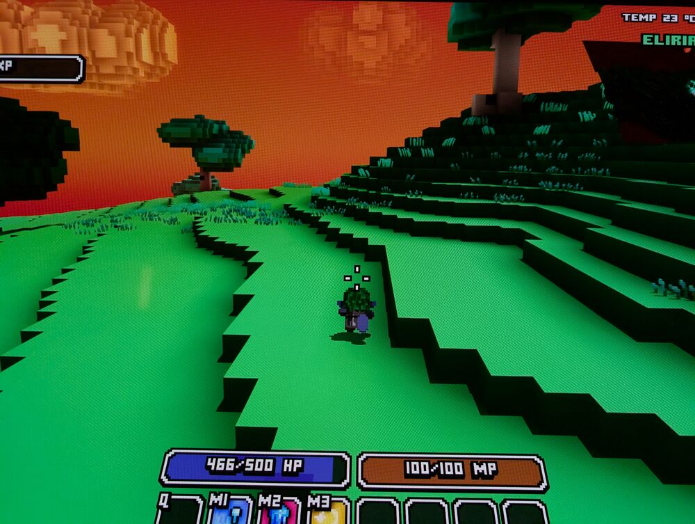

# Cube World Omega unter Linux

🇬🇧 [English version](README.md)

Spiele die **Cube World Omega** Beta unter Linux. Du brauchst Beta-Zugang und den
Wollay-Launcher von [wollay.com](https://wollay.com).

*Inoffiziell, nicht von Wollay.*

## Installieren

**1.** Lade den Launcher (`Wollay-Launcher-…-Setup.exe`) von wollay.com herunter.
Lass ihn im Ordner **Downloads** liegen (liegt er woanders, fragt dich das Installationsprogramm danach).

**2.** Öffne ein **Terminal**, füge diese Zeile ein und drücke **Enter**:

```sh
git clone https://github.com/GammelSami/cubeworld-omega-linux ~/Games/cubeworld-omega-linux && ~/Games/cubeworld-omega-linux/install.sh
```

Beim ersten Mal dauert das ein paar Minuten. Einfach warten.

**3.** Der Launcher öffnet sich. **Melde dich an.** Das Spiel lädt sich von selbst herunter.
Dann auf **Play** klicken.
Kommt die Anmeldung im Browser nicht im Launcher an, lösche im Browser die Cookies von
wollay.com und melde dich noch einmal an.

**Fertig!** Ab jetzt startest du **Cube World Omega** über dein App-Menü.

> Die Skripte landen in `Games/cubeworld-omega-linux` in deinem Home-Ordner, das Spiel in
> `Games/CubeWorldOmega`. Verschiebe oder lösche diese Ordner nicht. Das Spiel braucht sie.

## Probleme?

- **Launcher-Fenster ist winzig** (großer/4K-Bildschirm): führe
  `~/Games/cubeworld-omega-linux/install.sh --dpi 192` aus
- **„git: command not found“ / „Befehl nicht gefunden“**: installiere git (z. B.
  `sudo apt install git`, `sudo pacman -S git` oder `sudo dnf install git`) und wiederhole Schritt 2.
- **Alles andere**: Klicke im App-Menü mit der rechten Maustaste auf **Cube World Omega** und
  wähle **Fehlerbericht erstellen** (oder führe `~/Games/cubeworld-omega-linux/report.sh` aus).
  Das speichert eine Datei in deinem Downloads-Ordner, ohne deine Anmeldedaten.
  [Issue öffnen](https://github.com/GammelSami/cubeworld-omega-linux/issues), schreiben, was
  passiert ist, und die Datei anhängen.

## Aktualisieren oder deinstallieren

**Aktualisieren:** Wenn es hier neue Fixes gibt, klicke im App-Menü mit der rechten Maustaste
auf **Cube World Omega** und wähle **Linux-Fixes aktualisieren**. Oder füge das in ein Terminal
ein und drücke **Enter** (das Spiel selbst aktualisiert sich im Launcher):

```sh
git -C ~/Games/cubeworld-omega-linux pull
```

**Alles deinstallieren:** `~/Games/cubeworld-omega-linux/uninstall.sh`

## Was macht das?

Es installiert den Windows-Launcher mit Proton (über [umu](https://github.com/Open-Wine-Components/umu-launcher))
in `~/Games/CubeWorldOmega` und behebt drei Dinge, die unter Wine nicht funktionieren:

- **Downloads bleiben hängen.** Ein kleiner lokaler Proxy lädt die Spieldateien für den Launcher.
  Nur Verbindungen zu wollay.com und den Google-Anmeldediensten, die er nutzt, laufen darüber. Dafür wird ein eigenes Zertifikat **nur im
  Wine-Ordner des Spiels** vertraut, nicht von deinem System oder Browser.
- **Rot und Blau sind im Spiel vertauscht.** Ein kleiner Vulkan-Layer korrigiert die Farben.
  Er ist nur für dieses Spiel aktiv. Ohne ihn sieht das Spiel so aus:

  
- **Der Launcher stürzt manchmal beim Start ab.** Er wird automatisch neu gestartet.

Technische Details: [docs/TECHNICAL.md](docs/TECHNICAL.md)
